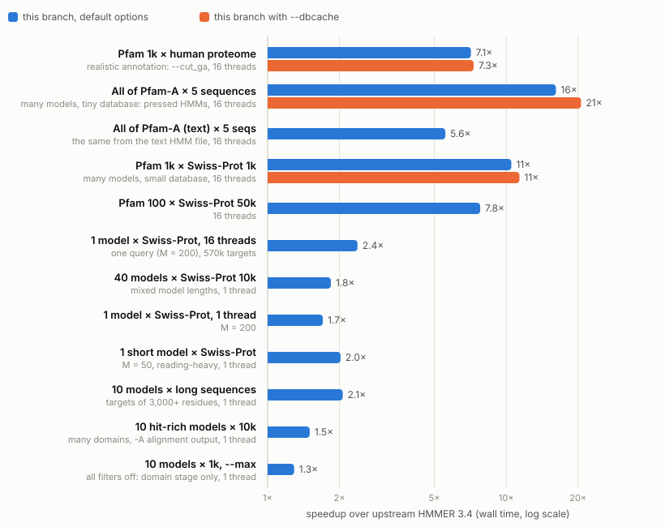
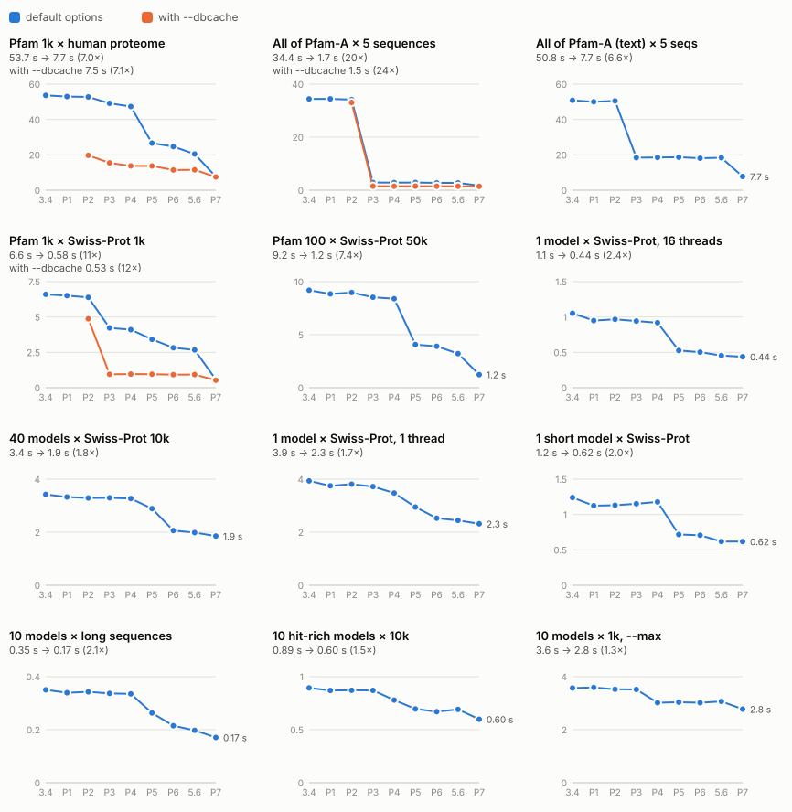

# hmmsearch speedups: results

What the work in [`PLAN.md`](PLAN.md) achieved. Upstream HMMER 3.4 and the end of every phase ran on the same workloads in one session (2026-10-07). **Every speedup comes with byte-identical output**: in each scenario, every binary's output files were compared with upstream's (dates and timings masked), and all matched. Per-step details are in [`PROGRESS.md`](PROGRESS.md), lessons in [`LEARNINGS.md`](LEARNINGS.md).

**Headline:**

- Realistic annotation, Pfam (1,000 families) against the human proteome with `--cut_ga`, 16 threads: **54 s → 7.7 s (7.0×)** by default, and the same with the opt-in `--dbcache` (7.5 s, 7.1×).
- All of Pfam-A (22k HMMs) against a few sequences, 16 threads: **34 s → 1.7 s (20×)** from the pressed file, 1.5 s (24×) with `--dbcache`; **51 s → 7.7 s (6.6×)** from the text file.
- Single-threaded runs: **1.3-2.1×**, depending on where the time goes (filters and parsing gained most, the domain stage least).

## Speedup over upstream, per scenario

<picture>
  <source media="(prefers-color-scheme: dark)" srcset="results/speedup-dark.svg">
  
</picture>

`--dbcache` keeps the parsed target database in memory across queries (Phase 2). It is opt-in, so its bars apply only where you pass it. Since Phase 7 a run with many queries reads each block of targets once for a whole batch of them, so the option gains little at these database sizes; it still saves reading where the targets fit in memory and the run has thousands of queries.

## Wall time at the end of every phase

<picture>
  <source media="(prefers-color-scheme: dark)" srcset="results/phases-dark.svg">
  
</picture>

`3.4` is upstream, `P1`-`P7` the end of each phase, and `5.6` Phase 6 plus step 5.6 (a faster FASTA residue path, done after Phase 6).

| Phase | What changed | Where it shows |
|---|---|---|
| 1. Bias filter | Streaming 2-state forward instead of a per-call matrix | 3-5% where the bias filter runs often (1 model × Swiss-Prot, long targets) |
| 2. Target database once | Opt-in `--dbcache`: the first query's pass keeps the parsed targets in memory | Multi-query runs with the option: 2.7× on the realistic run |
| 3. Per-query costs | Persistent worker threads, reused pipelines, queries prepared ahead in parallel, query-parallel mode for small cached databases | Many models × small databases: 12× on Pfam-A × 5 sequences |
| 4. Domain stage | Exact rewrites of the stochastic traceback, null2 and clustering hot spots | Hit-rich and `--max` runs: 10-14% |
| 5. FASTA parser (Easel) | 16 KB reads, one-pass validate + digitize, header scans with `memchr` | Runs that parse a large FASTA: realistic run −44%, Pfam 100 × Swiss-Prot 50k −51% |
| 6. Wider SIMD | AVX2 SSV, MSV and Viterbi filters (AVX-512 for models longer than 448), chosen at run time | Filter-heavy runs: 14-29% |
| 5.6 (after 6) | FASTA residues digitized through one table, 8 at a time | Uncached threaded runs: 9-18% |
| 7. Query batches, paired parsers | Up to 16 queries per pass over the targets, with consecutive batches overlapped; an exact fast `atof()` for text HMM files; the Forward/Backward parsers on two targets at once; a shorter bias-filter chain | Threaded runs with many queries: realistic 2.7×, Pfam 1k × Swiss-Prot 1k 4.6×, Pfam-A from text 2.4×; single-threaded runs with several queries or many hits 5-14% (one-query runs unchanged) |

## All numbers

Median wall time of 3 rounds (each round ran every binary once, in rotated order, after one untimed round that checked outputs).

| Scenario | upstream 3.4 | P1 | P2 | P3 | P4 | P5 | P6 | 5.6 | P7 | speedup |
|---|---:|---:|---:|---:|---:|---:|---:|---:|---:|---:|
| Pfam 1k × human proteome | 53.7 s | 53.0 s | 52.8 s | 49.1 s | 47.3 s | 26.6 s | 24.7 s | 20.5 s | 7.7 s | 7.0× |
| Pfam 1k × human proteome (--dbcache) | — | — | 19.7 s | 15.5 s | 13.8 s | 13.7 s | 11.4 s | 11.5 s | 7.5 s | 7.1× |
| All of Pfam-A × 5 sequences | 34.4 s | 34.5 s | 34.2 s | 2.9 s | 2.8 s | 2.9 s | 2.8 s | 2.7 s | 1.7 s | 20× |
| All of Pfam-A × 5 sequences (--dbcache) | — | — | 33.1 s | 1.5 s | 1.5 s | 1.5 s | 1.5 s | 1.5 s | 1.5 s | 24× |
| All of Pfam-A (text) × 5 sequences | 50.8 s | 50.0 s | 50.5 s | 18.4 s | 18.5 s | 18.7 s | 18.1 s | 18.4 s | 7.7 s | 6.6× |
| Pfam 1k × Swiss-Prot 1k | 6.6 s | 6.5 s | 6.4 s | 4.2 s | 4.1 s | 3.4 s | 2.8 s | 2.7 s | 0.58 s | 11× |
| Pfam 1k × Swiss-Prot 1k (--dbcache) | — | — | 4.9 s | 0.95 s | 0.96 s | 0.95 s | 0.93 s | 0.93 s | 0.53 s | 12× |
| Pfam 100 × Swiss-Prot 50k | 9.2 s | 8.8 s | 9.0 s | 8.5 s | 8.4 s | 4.1 s | 3.9 s | 3.2 s | 1.2 s | 7.4× |
| 1 model × Swiss-Prot, 16 threads | 1.1 s | 0.95 s | 0.97 s | 0.94 s | 0.92 s | 0.53 s | 0.50 s | 0.46 s | 0.44 s | 2.4× |
| 40 models × Swiss-Prot 10k | 3.4 s | 3.3 s | 3.3 s | 3.3 s | 3.3 s | 2.9 s | 2.1 s | 2.0 s | 1.9 s | 1.8× |
| 1 model × Swiss-Prot, 1 thread | 3.9 s | 3.7 s | 3.8 s | 3.7 s | 3.5 s | 2.9 s | 2.5 s | 2.4 s | 2.3 s | 1.7× |
| 1 short model × Swiss-Prot | 1.2 s | 1.1 s | 1.1 s | 1.2 s | 1.2 s | 0.72 s | 0.71 s | 0.62 s | 0.62 s | 2.0× |
| 10 models × long sequences | 0.35 s | 0.34 s | 0.34 s | 0.34 s | 0.34 s | 0.26 s | 0.21 s | 0.20 s | 0.17 s | 2.1× |
| 10 hit-rich models × 10k | 0.89 s | 0.87 s | 0.87 s | 0.87 s | 0.78 s | 0.70 s | 0.67 s | 0.69 s | 0.60 s | 1.5× |
| 10 models × 1k, --max | 3.6 s | 3.6 s | 3.5 s | 3.5 s | 3.0 s | 3.0 s | 3.0 s | 3.1 s | 2.8 s | 1.3× |

Peak memory: the realistic run takes 336 MB upstream and 351 MB now (per-thread state kept across queries, and the hit lists of a batch of up to 16 queries held until they're printed), 345 MB with `--dbcache`. Many models against a tiny database take 34 → 62 MB.

## How this was measured

- Machine: 16-vCPU Intel Xeon Platinum 8468 (Sapphire Rapids) KVM guest, 8 cores × 2 hyperthreads.
- Binaries: default `-O3` builds of upstream (the HMMER 3.4 source, f8bebd8) and of each phase's last commit (4088a0d, 5ad2fde, fa18adc, 4f62b07, f9dcb6b, aadf224, 7d637cb for `5.6`, 50882a6 for `P7`), each with the Easel commit it pins. Upstream differs from `master` only in `dev/` and `.gitignore`.
- Workloads: [`dev/perf/workloads.tsv`](../perf/workloads.tsv) (Pfam 37.0, Swiss-Prot, the human proteome; see [`dev/bench`](../bench)). Threaded runs pin `-Z`, so their outputs are deterministic.
- Wall times on this VM vary: the spread (max-min)/median of a binary's 3 rounds was up to 12% on the shortest or 16-thread runs, typically 3-6%, and upstream's realistic run measured 59 s the day before. That doesn't affect the conclusions here; per-step decisions in PROGRESS.md used CPU counters and interleaved A/Bs.
- Reproduce (about one and a half hours; the second `series.py` run adds the text Pfam-A scenario, and the two JSON files are merged by concatenating their `workloads` lists):

```
for p in p0:f8bebd8 p1:4088a0d p2:5ad2fde p3:fa18adc p4:4f62b07 p5:f9dcb6b p6:aadf224 p56:7d637cb p7:50882a6; do
  dev/perf/snap.sh --rev ${p#*:} --name series-${p%%:*}
done
S="series-p0 series-p1 series-p2 series-p3 series-p4 series-p5 series-p6 series-p56 series-p7"
L=upstream,P1,P2,P3,P4,P5,P6,5.6,P7
dev/perf/series.py $S --labels $L --reps 3 --out phases-a.json \
    --workloads '^(W[1-5]_|R1_|X1_p100_50k_cN$|X2_|X3_p1k_s1k_cN|X4_pfamA_h3m_cN|X5_)'
dev/perf/series.py $S --labels $L --reps 3 --out phases-b.json --workloads '^X4_pfamA_txt_cN$'
dev/perf/plot_series.py phases.json --outdir dev/profiling/results --xlabels "3.4,P1,P2,P3,P4,P5,P6,5.6,P7"
```

The raw samples (wall, user, sys, cycles, instructions, peak RSS per run) are in [`results/phases.json`](results/phases.json).
