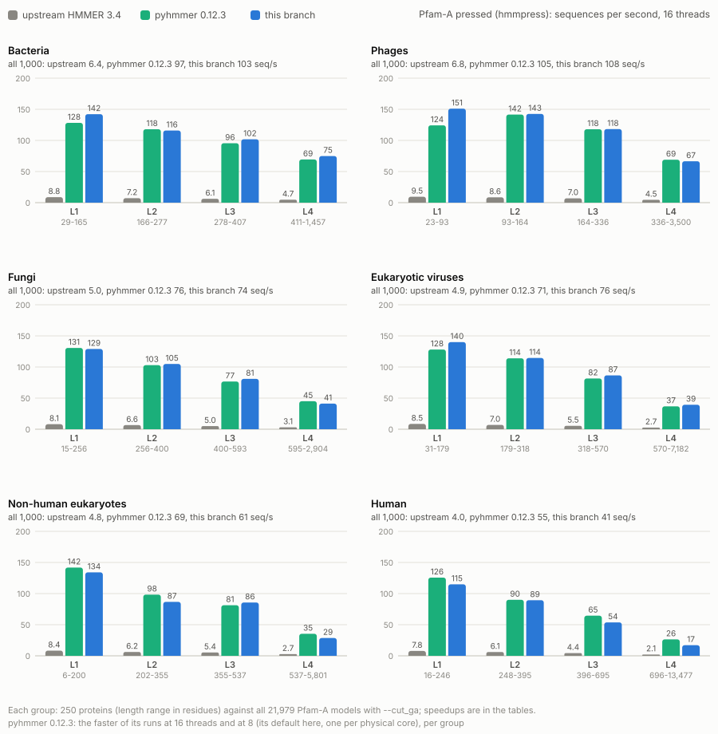
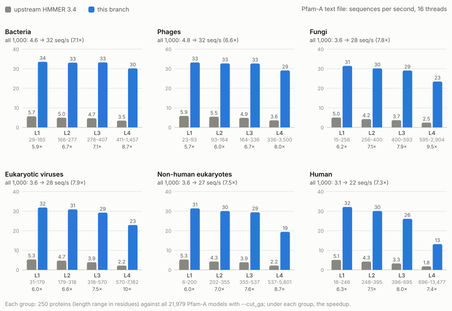

# hmmsearch speedups: results

What the work in [`PLAN.md`](PLAN.md) achieved, measured in two sessions:

- **2026-10-20, upstream vs [pyhmmer](https://github.com/althonos/pyhmmer) vs this branch:** HMMER 3.4, pyhmmer 0.12.3 (a Python binding of HMMER 3.4, which says it is faster than `hmmsearch` with several CPUs) and this branch at its latest commit ran on the same jobs, interleaved: the scenario chart and the annotation section. Method and findings: [`PYHMMER.md`](PYHMMER.md).
- **2026-10-09, phase by phase:** upstream and the end of every phase ran on the same workloads: the phase chart and the "All numbers, phase by phase" table.

**Every speedup comes with identical output.** In each run, this branch's output files were compared with upstream's (dates and timings masked), and all matched: the main output too on 2026-10-09, the `--tblout` and `--domtblout` tables on 2026-10-20. pyhmmer's tables matched upstream's except for numbers below 2.2e-308 that `hmmsearch` flushes to zero ([`PYHMMER.md`](PYHMMER.md), "Outputs"). Per-step details are in [`PROGRESS.md`](PROGRESS.md), lessons in [`LEARNINGS.md`](LEARNINGS.md).

**Headline:**

- Realistic annotation, Pfam (1,000 families) against the human proteome with `--cut_ga`, 16 threads: **56 s → 7.8 s (7.2×)**, by default or with the opt-in `--dbcache`. pyhmmer: 14.5 s (3.9×).
- All of Pfam-A (22k HMMs) against a few sequences, 16 threads: **23 s → 1.4 s (16×)** from the pressed file, 1.1 s (20×) with `--dbcache`; **38 s → 6.8 s (5.6×)** from the text file. pyhmmer: 2.1 s (11×) and 15.8 s (2.4×).
- Single-threaded runs: **1.3-2.1×**, depending on where the time goes (filters and parsing gained most, the domain stage least). pyhmmer: 0.54-1.1×.
- **Against pyhmmer, this branch is 1.5-5.4× faster in all 12 scenarios.**
- Annotating 1,000 Swiss-Prot proteins per taxon (bacteria, phages, fungi, viruses, eukaryotes, human) with all of Pfam-A, 16 threads: **5.2 → 69 sequences per second (13×)** from the pressed file, and **3.9 → 28 (7.4×)** from the text file ([below](#annotating-proteins-with-all-of-pfam-a)). pyhmmer: 75 (15×) from the pressed file, ahead of this branch on the long eukaryotic proteins, and 15 (3.8×) from the text file, which it reads with HMMER 3.4's parser.

## Upstream vs pyhmmer vs this branch, per scenario

<picture>
  <source media="(prefers-color-scheme: dark)" srcset="results/speedup-dark.svg">
  
</picture>

Measured on 2026-10-20, in one session: upstream 3.4, pyhmmer 0.12.3 and this branch (5935bd9: Phase 7 and step 7E.1). Every run writes `--tblout` and `--domtblout`. pyhmmer has no main output, and `hmmsearch` sends its own to `/dev/null`. pyhmmer is shown at the faster of 16 and 8 threads in each threaded scenario (8 is its default here, one thread per physical core; `*` in the table).

- **pyhmmer beats upstream on every threaded run with many queries: 2.4-11×.** It keeps the targets in memory, and each thread takes a whole query. So it pays neither of upstream's two big costs: re-reading the database for every query, and stopping all threads at the end of each one. This branch removed the same two costs in Phases 2, 3 and 7.
- **pyhmmer is slower than upstream in 5 of the 12 scenarios (0.39-0.86×).**
  - With one query against Swiss-Prot, it first reads all 570k sequences into memory, serially. That takes 1.4 s and 670-713 MB (this branch: 4-125 MB).
  - It doesn't flush subnormal numbers to zero, as `hmmsearch` does. That costs it up to 1.8× on hit-rich single-threaded runs. With flush-to-zero set, it matches upstream there.
  - On the other single-threaded runs it matches upstream (1.0-1.1×): it uses the same SSE kernels.
- **This branch is 1.5-5.4× faster than pyhmmer in every scenario.** Where both keep the targets in memory (`--dbcache`), it is 1.7-1.9× faster. The gains come from changes that pyhmmer's design doesn't give it:
  - the AVX2 and AVX-512 filters (Phase 6);
  - the paired Forward/Backward parsers and the domain-stage rewrites (Phases 4 and 7);
  - the FASTA reader, which streams the targets while the workers search (Phase 5);
  - the exact fast `atof()` for text HMM files (Phase 7). Reading the 21,979 text models is pyhmmer's floor: 15.8 s, against 6.8 s for this branch's whole run;
  - flush-to-zero itself.

Median wall time of 3 rounds:

| Scenario | upstream 3.4 | pyhmmer 0.12.3 | this branch | pyhmmer vs upstream | this branch vs upstream | this branch vs pyhmmer |
|---|---:|---:|---:|---:|---:|---:|
| Pfam 1k × human proteome | 56.0 s | 14.5 s | 7.8 s | 3.9× | 7.2× | 1.9× |
| Pfam 1k × human proteome (--dbcache) | — | — | 7.8 s | — | 7.2× | 1.9× |
| All of Pfam-A × 5 sequences | 22.8 s | 2.1 s* | 1.4 s | 11× | 16× | 1.5× |
| All of Pfam-A × 5 sequences (--dbcache) | — | — | 1.1 s | — | 20× | 1.9× |
| All of Pfam-A (text) × 5 seqs | 38.4 s | 15.8 s | 6.8 s | 2.4× | 5.6× | 2.3× |
| Pfam 1k × Swiss-Prot 1k | 5.9 s | 0.84 s* | 0.55 s | 7.0× | 11× | 1.5× |
| Pfam 1k × Swiss-Prot 1k (--dbcache) | — | — | 0.49 s | — | 12× | 1.7× |
| Pfam 100 × Swiss-Prot 50k | 8.5 s | 2.6 s | 1.2 s | 3.2× | 7.2× | 2.2× |
| 1 model × Swiss-Prot, 16 threads | 0.99 s | 2.5 s | 0.46 s | 0.39× | 2.1× | 5.4× |
| 40 models × Swiss-Prot 10k | 3.5 s | 3.3 s | 1.9 s | 1.0× | 1.8× | 1.7× |
| 1 model × Swiss-Prot, 1 thread | 3.9 s | 6.0 s | 2.3 s | 0.65× | 1.7× | 2.6× |
| 1 short model × Swiss-Prot | 1.2 s | 2.1 s | 0.57 s | 0.54× | 2.0× | 3.7× |
| 10 models × long sequences | 0.32 s | 0.30 s | 0.15 s | 1.1× | 2.1× | 2.0× |
| 10 hit-rich models × 10k | 0.83 s | 1.5 s | 0.57 s | 0.54× | 1.5× | 2.7× |
| 10 models × 1k, --max | 3.5 s | 4.1 s | 2.7 s | 0.86× | 1.3× | 1.5× |

\* pyhmmer at 8 threads, which was faster there.

`--dbcache` keeps the parsed target database in memory across queries (Phase 2). It is opt-in, so its bars apply only where you pass it. Since Phase 7, a run with many queries reads each block of targets once for a whole batch of them, so the option gains little at these database sizes. It still saves reading where the targets fit in memory and the run has thousands of queries.

## Wall time at the end of every phase

<picture>
  <source media="(prefers-color-scheme: dark)" srcset="results/phases-dark.svg">
  
</picture>

Measured on 2026-10-09. `3.4` is upstream, `P1`-`P7` the end of each phase, and `5.6` Phase 6 plus step 5.6 (a faster FASTA residue path, done after Phase 6).

| Phase | What changed | Where it shows |
|---|---|---|
| 1. Bias filter | Streaming 2-state forward instead of a per-call matrix | 4% where the bias filter runs often (1 model × Swiss-Prot, 1 thread) |
| 2. Target database once | Opt-in `--dbcache`: the first query's pass keeps the parsed targets in memory | Multi-query runs with the option: 2.9× on the realistic run |
| 3. Per-query costs | Persistent worker threads, reused pipelines, queries prepared ahead in parallel, query-parallel mode for small cached databases | Many models × small databases: 9.0× on Pfam-A × 5 sequences (19× with `--dbcache`) |
| 4. Domain stage | Exact rewrites of the stochastic traceback, null2 and clustering hot spots | Hit-rich and `--max` runs: 9-14% |
| 5. FASTA parser (Easel) | 16 KB reads, one-pass validate + digitize, header scans with `memchr` | Runs that parse a large FASTA: realistic run −45%, Pfam 100 × Swiss-Prot 50k −50% |
| 6. Wider SIMD | AVX2 SSV, MSV and Viterbi filters (AVX-512 for models longer than 448), chosen at run time | Filter-heavy runs: 16-29% |
| 5.6 (after 6) | FASTA residues digitized through one table, 8 at a time | Uncached threaded runs: 13-19% |
| 7. Query batches, paired parsers | Up to 16 queries per pass over the targets, with consecutive batches overlapped; an exact fast `atof()` for text HMM files; the Forward/Backward parsers on two targets at once; a shorter bias-filter chain | Threaded runs with many queries: realistic 2.7×, Pfam 1k × Swiss-Prot 1k 4.5×, Pfam-A from text 2.4×; single-threaded runs 5-15%, except the reading-bound one (1%) |
| 7E.1 (after 7) | A worker's domain-stage matrices trimmed after any target that grew them past 3 MB; big blocks get their own mappings (glibc) | Memory only: realistic run 350 → 220 MB, longest human proteins against Pfam-A 754 → 272 MB; at most 2% more CPU on the longest proteins |

## All numbers, phase by phase

Median wall time of 3 rounds on 2026-10-09 (each round ran every binary once, in rotated order, after one untimed round that checked outputs).

| Scenario | upstream 3.4 | P1 | P2 | P3 | P4 | P5 | P6 | 5.6 | P7 | speedup |
|---|---:|---:|---:|---:|---:|---:|---:|---:|---:|---:|
| Pfam 1k × human proteome | 56.4 s | 56.4 s | 55.4 s | 52.2 s | 49.8 s | 27.3 s | 25.8 s | 21.0 s | 7.9 s | 7.1× |
| Pfam 1k × human proteome (--dbcache) | — | — | 19.5 s | 15.6 s | 13.7 s | 13.7 s | 11.5 s | 11.5 s | 7.7 s | 7.3× |
| All of Pfam-A × 5 sequences | 23.6 s | 23.0 s | 23.2 s | 2.6 s | 2.6 s | 2.2 s | 2.2 s | 2.2 s | 1.5 s | 16× |
| All of Pfam-A × 5 sequences (--dbcache) | — | — | 21.8 s | 1.2 s | 1.2 s | 1.2 s | 1.1 s | 1.1 s | 1.1 s | 21× |
| All of Pfam-A (text) × 5 sequences | 40.6 s | 40.9 s | 40.4 s | 17.9 s | 18.0 s | 17.7 s | 17.6 s | 17.6 s | 7.3 s | 5.6× |
| Pfam 1k × Swiss-Prot 1k | 6.1 s | 6.0 s | 6.0 s | 4.1 s | 4.1 s | 3.4 s | 2.8 s | 2.6 s | 0.58 s | 11× |
| Pfam 1k × Swiss-Prot 1k (--dbcache) | — | — | 4.6 s | 0.96 s | 0.96 s | 0.98 s | 0.93 s | 0.93 s | 0.54 s | 11× |
| Pfam 100 × Swiss-Prot 50k | 9.5 s | 9.2 s | 9.0 s | 8.6 s | 8.4 s | 4.2 s | 3.9 s | 3.2 s | 1.2 s | 7.8× |
| 1 model × Swiss-Prot, 16 threads | 1.0 s | 0.93 s | 0.98 s | 0.95 s | 0.92 s | 0.51 s | 0.50 s | 0.43 s | 0.44 s | 2.4× |
| 40 models × Swiss-Prot 10k | 3.5 s | 3.5 s | 3.5 s | 3.4 s | 3.4 s | 3.0 s | 2.1 s | 2.1 s | 1.9 s | 1.8× |
| 1 model × Swiss-Prot, 1 thread | 4.1 s | 3.9 s | 4.0 s | 3.9 s | 3.6 s | 3.1 s | 2.6 s | 2.5 s | 2.4 s | 1.7× |
| 1 short model × Swiss-Prot | 1.2 s | 1.1 s | 1.1 s | 1.2 s | 1.2 s | 0.71 s | 0.71 s | 0.62 s | 0.61 s | 2.0× |
| 10 models × long sequences | 0.38 s | 0.38 s | 0.37 s | 0.36 s | 0.36 s | 0.28 s | 0.23 s | 0.21 s | 0.18 s | 2.1× |
| 10 hit-rich models × 10k | 0.92 s | 0.91 s | 0.91 s | 0.90 s | 0.82 s | 0.73 s | 0.70 s | 0.69 s | 0.61 s | 1.5× |
| 10 models × 1k, --max | 3.6 s | 3.7 s | 3.7 s | 3.7 s | 3.2 s | 3.2 s | 3.1 s | 3.1 s | 2.8 s | 1.3× |

Peak memory: the realistic run takes 341 MB upstream and 350 MB at the end of Phase 7 (per-thread state kept across queries, and the hit lists of a batch of up to 16 queries held until they're printed), 352 MB with `--dbcache`; step 7E.1 brought it to 220 MB (232 MB with `--dbcache`). Many models against a tiny database take 35 → 62 MB.

## Annotating proteins with all of Pfam-A

Six sets of 1,000 UniProtKB/Swiss-Prot proteins: bacteria, phages, fungi, viruses of eukaryotes, eukaryotes other than human, and human. Each set is split by length into four groups of 250, from L1 (shortest) to L4 (longest), at the set's own quartiles. How the sets were drawn: [`dev/bench/README.md`](../bench/README.md), "UniProt protein sets".

Every group was searched with all 21,979 Pfam-A models (`--cut_ga`, 16 threads) by upstream 3.4, pyhmmer 0.12.3 and this branch (5935bd9), in one session on 2026-10-20. Speed is sequences per second: 250 divided by the median wall time of 3 rounds. For the pressed file, pyhmmer is shown at the faster of 16 and 8 threads per group (`*` in the table). This branch's tables were identical to upstream's in all 48 runs. pyhmmer's matched upstream's, apart from numbers below 2.2e-308, and one hit's E-values in bacteria L4 and in human L4 (`0` in `hmmsearch`, 1.5e-307 and 3.7e-306 in pyhmmer: [`PYHMMER.md`](PYHMMER.md), "Outputs").

<picture>
  <source media="(prefers-color-scheme: dark)" srcset="results/annot-pressed-dark.svg">
  
</picture>

- **All 6,000 proteins, pressed Pfam-A: upstream 5.2, pyhmmer 75, this branch 69 sequences per second** (15× and 13× faster than upstream).
- **Why upstream is slow here.** 250 targets fit in one of its read blocks (1,000 sequences). So every model is searched by a single worker, and the run keeps 1.4-2.7 cores busy. pyhmmer gives each thread a whole model. This branch spreads each batch of up to 16 models over all the workers (Phase 7).
- **This branch against pyhmmer.** It is ahead by 5-22% in 9 groups and within 5% in 8. pyhmmer leads in 7, all of them eukaryotic. Its lead is largest on the longest proteins: human L4 (696-13,477 residues) 26 against 17 sequences per second, the other eukaryotes' L4 35 against 29.
- **Why pyhmmer leads on long proteins.** This branch needs less CPU time there (human L4: 84 CPU-s, pyhmmer 101-145), but it keeps only 5.7 cores busy, against pyhmmer's 15.
  - This branch prints results in query order and has at most 2 batches of 16 queries in flight. So a few slow pairs of a model and a long protein hold up the other workers.
  - pyhmmer instead keeps finished results in memory until it can return them in order, so no worker waits. Its peak memory for human L4 is 1,137 MB, against 265 MB.

<picture>
  <source media="(prefers-color-scheme: dark)" srcset="results/annot-text-dark.svg">
  
</picture>

- **From the text file: upstream 3.9, pyhmmer 15, this branch 28 sequences per second** (3.8× and 7.4× over upstream).
- **Reading 21,979 models from text sets a floor.** Against the pressed runs, the text file adds 15-18 s to each of upstream's runs, 10-14 s to pyhmmer's, and 3.8-5.8 s to this branch's.
  - pyhmmer reads the models with HMMER 3.4's own parser, in one thread, while its workers search. Its runs take 16.6-19.3 s whatever the protein length, so it is flat at 13-15 sequences per second.
  - This branch parses them with an exact fast `atof()` (Phase 7). That caps it near 30 sequences per second.
  - On human L4, the longest group, the search itself takes longest, and the two meet (14 against 13).
- **Pressing Pfam-A once with `hmmpress` removes this cost.** Pass `Pfam-A.hmm.h3m`, or `Pfam-A.hmm` with the pressed files next to it: `hmmsearch` then reads the binary models. pyhmmer reads `Pfam-A.hmm.h3m` too.

Sequences per second, pressed Pfam-A (median of 3 rounds; `*` pyhmmer at 8 threads, which was faster there):

| Set | Group | Lengths | upstream 3.4 | pyhmmer 0.12.3 | this branch | pyhmmer vs upstream | this branch vs upstream | this branch vs pyhmmer |
|---|---|---|---:|---:|---:|---:|---:|---:|
| Bacteria | L1 | 29-165 | 8.8 | 128* | 142 | 14× | 16× | 1.1× |
|  | L2 | 166-277 | 7.2 | 118* | 116 | 16× | 16× | 0.98× |
|  | L3 | 278-407 | 6.1 | 96* | 102 | 16× | 17× | 1.1× |
|  | L4 | 411-1,457 | 4.7 | 69 | 75 | 15× | 16× | 1.1× |
| | **all 1,000** | | **6.4** | **97** | **103** | **15×** | **16×** | **1.1×** |
| Phages | L1 | 23-93 | 9.5 | 124* | 151 | 13× | 16× | 1.2× |
|  | L2 | 93-164 | 8.6 | 142* | 143 | 16× | 17× | 1.0× |
|  | L3 | 164-336 | 7.0 | 118* | 118 | 17× | 17× | 1.0× |
|  | L4 | 336-3,500 | 4.5 | 69 | 67 | 15× | 15× | 0.97× |
| | **all 1,000** | | **6.8** | **105** | **108** | **15×** | **16×** | **1.0×** |
| Fungi | L1 | 15-256 | 8.1 | 131* | 129 | 16× | 16× | 0.99× |
|  | L2 | 256-400 | 6.6 | 103* | 105 | 16× | 16× | 1.0× |
|  | L3 | 400-593 | 5.0 | 77 | 81 | 15× | 16× | 1.1× |
|  | L4 | 595-2,904 | 3.1 | 45 | 41 | 15× | 13× | 0.92× |
| | **all 1,000** | | **5.0** | **76** | **74** | **15×** | **15×** | **0.98×** |
| Eukaryotic viruses | L1 | 31-179 | 8.5 | 128* | 140 | 15× | 16× | 1.1× |
|  | L2 | 179-318 | 7.0 | 114* | 114 | 16× | 16× | 1.0× |
|  | L3 | 318-570 | 5.5 | 82 | 87 | 15× | 16× | 1.1× |
|  | L4 | 570-7,182 | 2.7 | 37 | 39 | 14× | 15× | 1.1× |
| | **all 1,000** | | **4.9** | **71** | **76** | **15×** | **15×** | **1.1×** |
| Non-human eukaryotes | L1 | 6-200 | 8.4 | 142* | 134 | 17× | 16× | 0.95× |
|  | L2 | 202-355 | 6.2 | 98* | 87 | 16× | 14× | 0.88× |
|  | L3 | 355-537 | 5.4 | 81 | 86 | 15× | 16× | 1.1× |
|  | L4 | 537-5,801 | 2.7 | 35 | 29 | 13× | 11× | 0.81× |
| | **all 1,000** | | **4.8** | **69** | **61** | **14×** | **13×** | **0.88×** |
| Human | L1 | 16-246 | 7.8 | 126* | 115 | 16× | 15× | 0.91× |
|  | L2 | 248-395 | 6.1 | 90* | 89 | 15× | 15× | 0.99× |
|  | L3 | 396-695 | 4.4 | 65 | 54 | 15× | 12× | 0.83× |
|  | L4 | 696-13,477 | 2.1 | 26 | 17 | 12× | 8.0× | 0.64× |
| | **all 1,000** | | **4.0** | **55** | **41** | **14×** | **10×** | **0.74×** |
| **All six** | **6,000** | | **5.2** | **75** | **69** | **15×** | **13×** | **0.92×** |

Sequences per second, text Pfam-A (median of 3 rounds; pyhmmer at 16 threads):

| Set | Group | Lengths | upstream 3.4 | pyhmmer 0.12.3 | this branch | pyhmmer vs upstream | this branch vs upstream | this branch vs pyhmmer |
|---|---|---|---:|---:|---:|---:|---:|---:|
| Bacteria | L1 | 29-165 | 5.6 | 15 | 33 | 2.7× | 5.9× | 2.2× |
|  | L2 | 166-277 | 4.9 | 15 | 32 | 3.1× | 6.6× | 2.2× |
|  | L3 | 278-407 | 4.5 | 15 | 32 | 3.3× | 7.1× | 2.1× |
|  | L4 | 411-1,457 | 3.5 | 15 | 29 | 4.2× | 8.3× | 2.0× |
| | **all 1,000** | | **4.5** | **15** | **32** | **3.3×** | **7.0×** | **2.1×** |
| Phages | L1 | 23-93 | 5.9 | 15 | 34 | 2.6× | 5.7× | 2.2× |
|  | L2 | 93-164 | 5.5 | 15 | 33 | 2.7× | 6.1× | 2.2× |
|  | L3 | 164-336 | 4.8 | 15 | 32 | 3.1× | 6.7× | 2.1× |
|  | L4 | 336-3,500 | 3.5 | 15 | 29 | 4.2× | 8.1× | 1.9× |
| | **all 1,000** | | **4.7** | **15** | **32** | **3.2×** | **6.7×** | **2.1×** |
| Fungi | L1 | 15-256 | 5.2 | 15 | 33 | 2.9× | 6.3× | 2.2× |
|  | L2 | 256-400 | 4.4 | 15 | 31 | 3.3× | 7.1× | 2.1× |
|  | L3 | 400-593 | 3.8 | 15 | 30 | 3.9× | 8.0× | 2.0× |
|  | L4 | 595-2,904 | 2.6 | 14 | 24 | 5.6× | 9.4× | 1.7× |
| | **all 1,000** | | **3.7** | **15** | **29** | **4.0×** | **7.8×** | **2.0×** |
| Eukaryotic viruses | L1 | 31-179 | 5.5 | 15 | 33 | 2.7× | 6.0× | 2.2× |
|  | L2 | 179-318 | 4.8 | 15 | 32 | 3.1× | 6.7× | 2.1× |
|  | L3 | 318-570 | 4.0 | 15 | 30 | 3.7× | 7.6× | 2.0× |
|  | L4 | 570-7,182 | 2.3 | 14 | 24 | 6.2× | 10× | 1.7× |
| | **all 1,000** | | **3.7** | **15** | **29** | **4.0×** | **7.9×** | **2.0×** |
| Non-human eukaryotes | L1 | 6-200 | 5.5 | 15 | 33 | 2.7× | 6.0× | 2.2× |
|  | L2 | 202-355 | 4.4 | 15 | 31 | 3.3× | 7.0× | 2.1× |
|  | L3 | 355-537 | 4.0 | 15 | 31 | 3.7× | 7.7× | 2.1× |
|  | L4 | 537-5,801 | 2.3 | 14 | 20 | 6.1× | 8.7× | 1.4× |
| | **all 1,000** | | **3.7** | **15** | **28** | **4.0×** | **7.5×** | **1.9×** |
| Human | L1 | 16-246 | 5.1 | 15 | 33 | 2.9× | 6.4× | 2.2× |
|  | L2 | 248-395 | 4.3 | 15 | 31 | 3.4× | 7.2× | 2.1× |
|  | L3 | 396-695 | 3.4 | 15 | 27 | 4.4× | 7.9× | 1.8× |
|  | L4 | 696-13,477 | 1.9 | 13 | 14 | 7.0× | 7.3× | 1.0× |
| | **all 1,000** | | **3.2** | **14** | **23** | **4.5×** | **7.2×** | **1.6×** |
| **All six** | **6,000** | | **3.9** | **15** | **28** | **3.8×** | **7.4×** | **1.9×** |

**Peak memory grows with protein length.**

- **Pressed file:** upstream 33-192 MB, this branch 71-340 MB, pyhmmer 48-1,137 MB. All three peak on human L4, except this branch, which peaks on viruses L4. Text runs are about the same, except pyhmmer: at most 856 MB.
- **This branch stays above upstream on the longest proteins.** Its 16 workers each hold domain-stage matrices for the largest region they have met, all at once, where upstream has one worker searching. Step 7E.1 trims them after any target that needed more than 3 MB. At the end of Phase 7 they reached 754 MB, against 265 MB now for human L4.
- **pyhmmer holds both its matrices and every finished result** until it can return it in order.

The earlier two-way session (upstream against Phase 7, 2026-10-07 and 2026-10-09) measured the same totals within 3%: pressed 5.2 → 71, text 3.8 → 28 sequences per second. Its samples are in [`results/annot.json`](results/annot.json).

## How this was measured

- Machine: 16-vCPU Intel Xeon Platinum 8468 (Sapphire Rapids) KVM guest, 8 cores × 2 hyperthreads.
- Workloads: [`dev/perf/workloads.tsv`](../perf/workloads.tsv) (Pfam 37.0, Swiss-Prot, the human proteome; see [`dev/bench`](../bench)). Threaded runs pin `-Z` or use `--cut_ga`, so their outputs are deterministic. The annotation sets come from UniProt release 2026_03: `dev/bench/uniprot.py fetch` downloads exactly those proteins (see [`dev/bench/README.md`](../bench/README.md)). Their workloads are [`dev/perf/annot.tsv`](../perf/annot.tsv).
- All runs were timed without `perf stat`, except the single-threaded ones (`W1`-`W5`, `R1`) on 2026-10-09, which also collected counters with it. Until 2026-10-07 every timed round ran under `perf stat`, which slows threaded runs that synchronize often on this VM, upstream's most ([`LEARNINGS.md`](LEARNINGS.md), measuring item 20). The previous version of this page overstated two speedups that way: all of Pfam-A × 5 sequences took 34.4 s upstream under `perf stat` and 23.6 s without (20× → 16×); from the text file, 50.8 s → 40.6 s (6.6× → 5.6×). The other scenarios moved by less than the day-to-day noise.
- **Phase by phase (2026-10-09):**
  - Binaries: default `-O3` builds of upstream (the HMMER 3.4 source, f8bebd8) and of each phase's last commit (4088a0d, 5ad2fde, fa18adc, 4f62b07, f9dcb6b, aadf224, 7d637cb for `5.6`, 50882a6 for `P7`), each with the Easel commit it pins. Upstream differs from `master` only in `dev/` and `.gitignore`.
  - Spread: wall times on this VM vary. The spread (max-min)/median of a binary's 3 rounds was 2.7% at the median and up to 12% (the 2 s pressed Pfam-A run). Upstream's realistic run measured 54-59 s on other days. That doesn't affect the conclusions here; per-step decisions in PROGRESS.md used CPU counters and interleaved A/Bs.
  - Raw samples (wall, user, sys, cycles, instructions, peak RSS per run): [`results/phases.json`](results/phases.json).
- **Upstream vs pyhmmer vs this branch (2026-10-20)** (details in [`PYHMMER.md`](PYHMMER.md)):
  - Binaries: upstream (f8bebd8) and this branch at 5935bd9 (the end of Phase 7 and step 7E.1; no code changed after it), `-O3`, GCC 13.3. pyhmmer 0.12.3 from PyPI, on Python 3.12.3. Its wheel holds HMMER 3.4's SSE code, built for SSE4.1 with GCC 14.2.
  - pyhmmer runs through [`dev/perf/pyhmmsearch.py`](../perf/pyhmmsearch.py), a command-line driver that takes the `hmmsearch` options used here. It reads the targets into memory once, calls `pyhmmer.hmmer.hmmsearch` as pyhmmer's documentation recommends, and writes the tables with `TopHits.write()`. Its wall time includes Python's start and imports (0.05 s).
  - Workloads: [`dev/perf/vs_pyhmmer.tsv`](../perf/vs_pyhmmer.tsv), the scenarios and annotation groups above. Every run writes `--tblout` and `--domtblout`, and `hmmsearch` sends its main output to `-o /dev/null` (W1 without `-A`).
  - Threads: a calibration run found pyhmmer faster at 8 threads on some workloads and at 16 on others, so it ran at both, as two contenders. The charts and tables show the faster of the two per threaded run. The text annotation runs used 16 only: they are bound by reading the models, and the two settings were within 1%.
  - Each session ran 1 untimed round that checked outputs, then 3 timed rounds. Every round ran each contender once per workload, in an order rotated each round. Output check: the tables, after dropping the `# Program: ...` block that `hmmsearch` appends (pyhmmer doesn't write it), with numbers below 2.2e-308 compared as 0 and counted per contender.
  - Spread (max-min)/median of a contender's 3 rounds: scenarios 2.7% at the median, up to 23% (this branch's 0.46 s X2 run); pressed annotation 2.9%, up to 13%; text annotation 0.8%, up to 3.4%.
  - Raw samples: [`results/vs-scen.json`](results/vs-scen.json), [`results/vs-annot-pressed.json`](results/vs-annot-pressed.json), [`results/vs-annot-text.json`](results/vs-annot-text.json). They also hold pyhmmer with flush-to-zero set (`pyhmmer-ftz`), which isn't charted ([`PYHMMER.md`](PYHMMER.md)).
- **The earlier two-way annotation session:** upstream and `P7`, the pressed runs and the bacteria and phage text runs on 2026-10-07, the other text runs on 2026-10-09 (a VM reboot stopped the first run). Raw samples: [`results/annot.json`](results/annot.json).
- Reproduce, phase by phase (about one and a half hours). The second `series.py` run adds the text Pfam-A scenario; merge the two JSON files by concatenating their `workloads` lists:

```
for p in p0:f8bebd8 p1:4088a0d p2:5ad2fde p3:fa18adc p4:4f62b07 p5:f9dcb6b p6:aadf224 p56:7d637cb p7:50882a6; do
  dev/perf/snap.sh --rev ${p#*:} --name series-${p%%:*}
done
S="series-p0 series-p1 series-p2 series-p3 series-p4 series-p5 series-p6 series-p56 series-p7"
L=upstream,P1,P2,P3,P4,P5,P6,5.6,P7
dev/perf/series.py $S --labels $L --reps 3 --out phases-a.json \
    --workloads '^(W[1-5]_|R1_|X1_p100_50k_cN$|X2_|X3_p1k_s1k_cN|X4_pfamA_h3m_cN|X5_)'
dev/perf/series.py $S --labels $L --reps 3 --out phases-b.json --workloads '^X4_pfamA_txt_cN$'
dev/perf/plot_series.py phases.json --outdir dev/profiling/results --charts phases --xlabels "3.4,P1,P2,P3,P4,P5,P6,5.6,P7"
```

- Reproduce, upstream vs pyhmmer vs this branch (about 4.5 hours: scenarios 25 minutes, pressed annotation 1 h 40 min, text 2 h 25 min). `dev/bench/uniprot.py fetch` first, for the annotation sets:

```
dev/perf/snap.sh --rev 5935bd9 --name series-p7e1
dev/perf/pyhmmer.sh; dev/perf/pyhmmer.sh --cpus 8; dev/perf/pyhmmer.sh --ftz
S="dev/perf/series.py --file vs_pyhmmer.tsv --mask-tail --flush-subnormals --reps 3"
ALL="series-p0 pyhmmer-0.12.3 pyhmmer-0.12.3-c8 pyhmmer-0.12.3-ftz series-p7e1 --labels upstream,pyhmmer,pyhmmer-c8,pyhmmer-ftz,fork"
$S $ALL --workloads '^(X|W|R)' --out vs-scen.json
$S $ALL --workloads '^A_[a-z]+_L[1-4]$' --out vs-annot-pressed.json
$S series-p0 pyhmmer-0.12.3 series-p7e1 --labels upstream,pyhmmer,fork --workloads '^A_[a-z]+_L[1-4]_txt$' --out vs-annot-text.json
dev/perf/plot_series.py vs-scen.json --outdir dev/profiling/results --charts speedup --speedup pyhmmer,fork \
    --best-of pyhmmer,pyhmmer-c8 --drop pyhmmer-ftz --legend "pyhmmer=pyhmmer 0.12.3" --legend "pyhmmer-c8=8 threads" \
    --note "pyhmmer 0.12.3: the faster of its runs at 16 threads and at 8 (its default here, one per physical core), per threaded run"
dev/perf/plot_annot.py vs-annot-pressed.json --outdir dev/profiling/results \
    --best-of pyhmmer,pyhmmer-c8 --drop pyhmmer-ftz --legend "pyhmmer=pyhmmer 0.12.3" --legend "pyhmmer-c8=8 threads" \
    --note "pyhmmer 0.12.3: the faster of its runs at 16 threads and at 8 (its default here, one per physical core), per group"
dev/perf/plot_annot.py vs-annot-text.json --outdir dev/profiling/results --legend "pyhmmer=pyhmmer 0.12.3" \
    --note "pyhmmer 0.12.3 at 16 threads: reading the text models bounds it, and 8 threads were within 1% in a calibration run"
```
